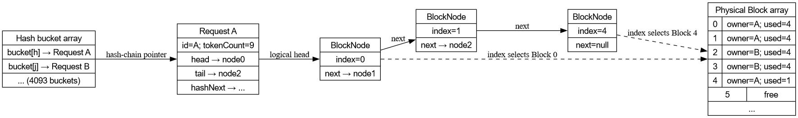
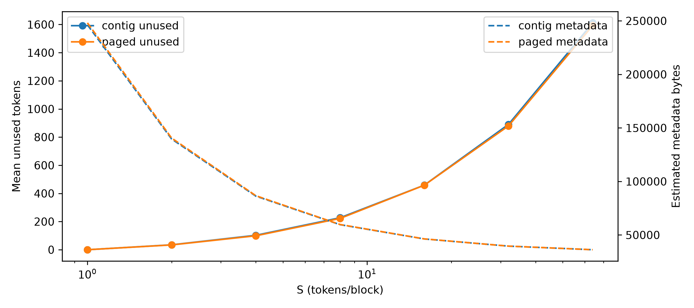

# MiniKV：面向 LLM 推理的 KV Cache 内存管理

使用 C++17 实现的轻量级 KV Cache 内存管理模拟器，比较**连续分配**与**分页分配**在动态请求、交错增长和碎片化条件下的行为。项目不运行大语言模型，也不存储真实 Key/Value 张量，而是用 token 计数、物理块数组和请求元数据研究内存管理。

## 核心功能

- **连续分配**：首次适配，选择起点最小的可用连续区间；追加只能使用原区间右侧紧邻的块，不搬迁。
- **分页分配**：按物理编号从小到大取空闲块，以逻辑链表连接；无需物理连续。
- **统一接口**：`allocate`、`append`、`free`、`lookup`、`displayMemory`、`displayRequest`。
- **失败原子性**：普通参数／容量检查失败后，原 token 数、块归属和链表不变。
- **手工数据结构**：物理块数组、4093 桶的链地址哈希表、每请求的 BlockNode 链表。

实际哈希函数为32位无符号131滚动哈希，最终对4093取模。项目保留原始策略逻辑，实验驱动独立获取和统计状态。

## 系统结构



`Request::hashNext` 连接哈希冲突链，`BlockNode::next` 连接请求的逻辑块；节点 `index` 指向物理 Block 数组，两个链的含义不同。

## 实验与验证

- 官方样例和独立 Python 参考模型差分测试。
- 每种策略6006组对拍，包括小规模随机、较大随机、官方生成器与显式边界用例。
- 880个反馈式解码实验配置，逐操作返回值与参考驱动结果核对。
- 块大小2、4、8、16；另含1、32、64的趋势实验。
- 固定总 token 容量、固定块数对照、棋盘空洞、交错追加、立即抢占及等待重试。
- 指标包括申请／追加失败率、利用率、内部浪费、外部碎片、占用率、完整完成数和部分元数据估算。
- 独立计时比较 lookup、allocate、append；另比较实际131、ASCII求和、31滚动哈希与FNV-1a分布。



### 值得注意的结论

1. 总空闲量充足，不代表连续策略能够申请或追加成功；右邻居限制在交错增长中尤其重要。
2. 分页的空闲块也可能物理分散，但这不会像连续分配那样阻止利用这些空闲块。
3. 小块降低尾块浪费，却增加块链节点；最佳大小取决于请求分布与元数据成本。
4. 当前分页实现每次合法追加都完整统计空闲块，尾块有余量时仍有线性扫描；这是实现细节，不是分页思想必然要求。

## 目录

```text
minikv/
  src/                 C++接口及两种策略
  harness/             指标回放与独立计时
  tests/               Python参考模型、边界输入、官方生成器输入存档
  workloads/gen.py     固定种子负载生成器
  results/tables/      CSV和中文Markdown汇总表
  results/figs/        PNG/PDF图
  run_all.py           编译、测试和实验入口
  complete.py          反馈仿真及补充实验
  ALGORITHM_NOTES.md   算法、伪代码与复杂度
  FINAL_NOTES.md       实验方法、结果解释及局限
```

## 快速运行

已验证环境：Windows、Python 3.11、MSYS2 UCRT64 g++ 16.2；编译选项 `-std=c++17 -O2 -static`。

```text
python -m pip install -r requirements.txt
cd minikv
python run_all.py --stage test
python run_all.py --stage experiment
python run_all.py --stage supplement
```

全部执行：`python run_all.py`。默认查找 `g++`，或使用 `CXX` 指定编译器路径。Windows建议将仓库克隆到无空格英文目录。

完整实验会产生较大的逐操作CSV和trace，运行可能耗时较长。仓库保留汇总、图表和官方生成器输入；可再生成的逐操作数据与负载文件不纳入Git。官方生成器使用 `random_device`，因此存档完整输入而不是宣称可通过固定种子复原；其他随机实验使用种子0～9。

## 数据使用与限制

- 反馈实验共享外部到达事件；抢占会导致内部操作序列不同。严格相同操作序列比较使用固定轨迹。
- 新反馈结果文件名含 `feedback`；旧固定轨迹的成功释放次数不能当成完整生成请求数。
- 汇总元数据不包括全部字符串、分配器和请求节点开销，不等于进程实际内存。
- Windows微基准受频率、调度与计时器开销影响；没有真实GPU推理性能含义。
- 不包含个人实验报告、个人身份信息、课程PDF和任务说明。

## 进一步阅读

- [数据结构、伪代码与复杂度](minikv/ALGORITHM_NOTES.md)
- [实验设计和结果解读](minikv/FINAL_NOTES.md)
- Kwon et al. *Efficient Memory Management for Large Language Model Serving with PagedAttention*. SOSP 2023.
